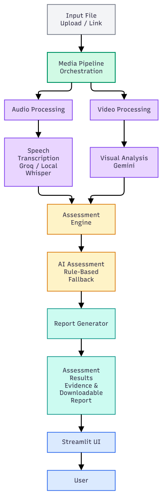

# Classroom Quality Assessment AI

## Project Overview

Classroom Quality Assessment AI is a Streamlit-based application that analyses classroom recordings and generates a provisional assessment of teaching practices.

The application processes video and audio, transcribes spoken content, analyses selected video frames, and evaluates teaching-related criteria. It generates an assessment report containing criterion-level scores, supporting evidence, and visual observations to assist human reviewers.

**Note:** Assessment results are provisional and require human review.

## Architecture
The application processes classroom recordings through a central media pipeline. Audio and video are analysed in parallel to extract speech transcripts and visual observations. The assessment engine combines the available evidence to generate a provisional assessment, which is presented through the Streamlit interface and made available as a downloadable report.



## Workflow

Input: The user uploads a classroom recording or provides a supported video link.

Media Pipeline: Coordinates the processing workflow.

Audio and Video Processing: Extracts audio and samples representative video frames.

Analysis: Transcribes speech and analyses selected frames.

Assessment: Evaluates teaching-related criteria using available evidence.

Reporting: Generates assessment results and a downloadable report.

## Key Features

- **Video Input:** Upload classroom videos or provide supported video download links.
- **Audio Processing:** Extract audio and transcribe spoken content.
- **Visual Analysis:** Sample video frames and identify relevant visual observations.
- **Teaching Assessment:** Evaluate teaching-related criteria using available assessment components.
- **Evidence-Based Reports:** Present assessment scores and supporting evidence.
- **Report Download:** Generate and download assessment reports in Markdown format.
- **Fallback Assessment:** Use fallback assessment logic when supported AI services are unavailable.

## Technology Stack

- Python
- Streamlit
- FFmpeg and FFprobe
- Speech transcription services
- Large language models for assessment and visual analysis
- Markdown report generation

## Prerequisites

Before running the application, ensure you have:

- Python installed
- FFmpeg and FFprobe installed and available on your system `PATH`
- Required Python dependencies listed in `requirements.txt`
- Valid API keys for the external services enabled in your configuration

The setup instructions below use Windows PowerShell.

## Running the Application Locally

### 1. Clone or open the repository

If you have already cloned the repository, open a terminal in the project root directory.

To clone the repository:

```bash
git clone <YOUR_REPOSITORY_URL>
cd <YOUR_REPOSITORY_FOLDER>
```

Replace the placeholders with your actual repository URL and folder name.

### 2. Create a virtual environment

```powershell
python -m venv .venv
```

Activate it:

```powershell
.\.venv\Scripts\Activate.ps1
```

If PowerShell blocks activation, run the following command in the current terminal session and try again:

```powershell
Set-ExecutionPolicy -Scope Process -ExecutionPolicy Bypass
.\.venv\Scripts\Activate.ps1
```

### 3. Install dependencies

Upgrade pip and install the required packages:

```powershell
python -m pip install --upgrade pip
pip install -r requirements.txt
```

### 4. Install FFmpeg

Install FFmpeg for your operating system and ensure both `ffmpeg` and `ffprobe` are available on your system `PATH`.

Verify the installation:

```powershell
ffmpeg -version
ffprobe -version
```

If either command is not recognized, configure your FFmpeg installation and reopen the terminal.

### 5. Configure environment variables

Create a `.env` file in the project root and configure the API keys and settings required by the application.

Example:

```dotenv
GROQ_API_KEY=your_groq_api_key
GEMINI_API_KEY=your_gemini_api_key

GROQ_MODEL=whisper-large-v3
GROQ_ASSESSMENT_MODEL=openai/gpt-oss-20b

GEMINI_VISION_MODEL=your_available_model
GEMINI_ASSESSMENT_MODEL=your_available_model

VIDEO_MAX_FRAMES=8
ASSESSMENT_MAX_TRANSCRIPT_CHARS=12000
MAX_VIDEO_UPLOAD_MB=250
```

Use model identifiers supported by your configured services. Retain any additional environment variables required by your project.

**Security:** Never commit `.env`, API keys, or private recordings to GitHub. Add sensitive configuration files to `.gitignore`. For hosted deployments, configure secrets through the hosting platform's settings.

### 6. Start the application

Run the following command from the project root:

```powershell
streamlit run app.py
```

Streamlit will display a local URL in the terminal, usually:

```text
http://localhost:8501
```

Open this URL in your browser if the application does not open automatically.

## How to Use the Application

1. Open the application in your browser.
2. Upload a supported classroom video or provide a supported video link.
3. Start the assessment and wait for processing to complete.
4. Review the assessment scores, supporting evidence, visual observations, and processing warnings.
5. Download the generated report.
6. Review the results before using them for any assessment or decision.

URL input supports direct public HTTPS video-download links and Google Drive share links when the necessary permissions are available. Ordinary streaming-platform pages may not be supported.

## Project Structure

```text
class-quality-ai/
├── app.py
├── README.md
├── requirements.txt
├── .env
├── .gitignore
├── .streamlit/
└── src/
    ├── media_pipeline.py
    ├── media_processor.py
    ├── audio_analyzer.py
    ├── transcription.py
    ├── transcription_groq.py
    ├── transcription_service.py
    ├── transcription_chunked.py
    ├── audio_analyzer.py
    ├── video_analyzer_gemini.py
    ├── assessment_engine.py
    ├── llm_assessment_engine.py
    └── report_generator.py
```

*Note: The exact files may vary depending on the current version of the repository.*

## Privacy and Responsible Use

- Process only recordings you are authorized to use.
- Follow applicable consent, organizational, and data-handling requirements.
- Media and transcript data may be processed by external services, depending on the configuration.
- Avoid uploading identifiable classroom recordings to external services without appropriate authorization.
- Treat automated assessments as provisional and require human review.


